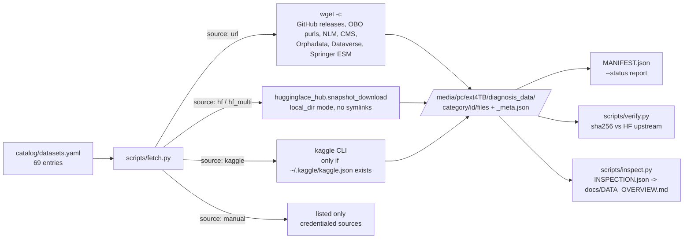

# Architecture

Last updated: 2026-11-05

A deliberately small system: one declarative catalog, one idempotent fetch
script, data on an external exFAT drive.

## Components

- **catalog/datasets.yaml** – the only place datasets are defined. Fields: `id`,
  `category` (drive folder), `source`, locator (`files[]` with url+name, `repo`,
  `repos[]`, or `slug`), `license`, `url` (homepage), `coverage` (what
  diseases/symptoms it adds), `note` (manual entries).
- **scripts/fetch.py** – iterates the catalog, downloads into
  `<data_root>/<category>/<id>/`, then writes `_meta.json` containing per-file
  sha256 and sizes. Existence of `_meta.json` = complete, so re-runs are
  idempotent and interrupted downloads resume (`wget -c`, HF resume).
  Failures are written to `_FAILED.txt` and the run continues with the next
  dataset. A `_LOCK` file (pid) prevents two processes from downloading the same
  dataset. `--status` prints a timestamped table; `--manifest` aggregates all
  `_meta.json` into `MANIFEST.json`.
- **scripts/verify.py** – for every complete Hugging Face dataset, compares the
  local file list with the repo's: LFS files must match sha256 and size. Run after
  every fetch run.
- **scripts/inspect.py** – read-only inventory of every file (format, columns, row
  counts, zip members) into `INSPECTION.json`; the basis of `docs/DATA_OVERVIEW.md`.

## Design decisions

- **exFAT drive** – no symlinks, so Hugging Face downloads use `local_dir`
  (plain files) rather than the symlinked cache; the HF `.cache` bookkeeping
  folder is removed after each successful snapshot.
- **Raw files, not a unified schema** – datasets are stored exactly as
  published (zips unextracted) so licences and provenance stay clear;
  normalisation into a common disease/symptom schema is a later step.
- **Coverage by layering** – terminologies define the universe of diseases and
  symptoms, knowledge graphs give disease↔symptom links with frequencies, case
  and dialogue datasets give realistic presentations. No single source covers
  more than a few thousand diseases, so breadth comes from the union.
- **No credentials in the pipeline** – anything requiring an account is a
  `manual` entry with instructions, never a stored secret.
