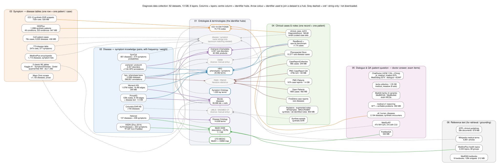
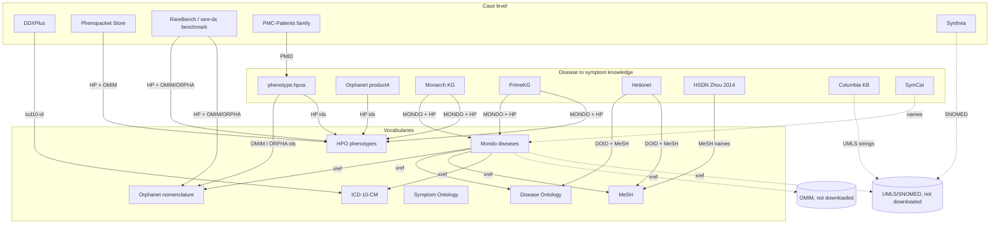

# Data overview: what is on the drive, what the files contain, how the datasets relate

Last updated: 2026-11-05. Data root: `/media/pc/ext4TB/diagnosis_data/`.
Catalog with source URLs and licences: `catalog/datasets.yaml`. Per-file sizes and
sha256: `<category>/<id>/_meta.json` and `MANIFEST.json`. Column/row inventory used
for this document: `INSPECTION.json` (produced by `scripts/inspect.py`).

Row counts below come from the files themselves (counted 2026-11-05); counts marked
≈ were taken from the publisher.

---

## 1. Layout and conventions

```
diagnosis_data/
  01_ontologies_terminologies/   what diseases and symptoms exist (names, synonyms, hierarchies, cross-refs)
  02_disease_symptom_knowledge/  which symptoms belong to which disease, with frequencies/weights
  03_symptom_disease_tabular/    one row = one patient or one disease, symptoms as columns/lists/text, diagnosis label
  04_clinical_cases_notes/       free-text case reports and notes with a diagnosis
  05_dialogue_qa/                patient questions, doctor answers, exam questions, reasoning chains
  06_reference_text/             encyclopaedic prose per disease
  _logs/                         download logs
  MANIFEST.json  INSPECTION.json  README.md
```

- Files are stored **exactly as published**; zips and tar.gz are not extracted.
- Formats: OBO/JSON (ontologies), XML (MeSH, Orphanet, MedlinePlus), CSV/TSV, JSON / JSONL,
  Parquet (most Hugging Face datasets).
- Reading Parquet: `pyarrow` ≥ 20 is needed for `medbullets`, `diagnosis_arena` and
  `clinical_case_icd10_diagnosis` (pyarrow 19 raises "Repetition level histogram size
  mismatch"; the files are byte-identical to upstream). Everything else reads with pyarrow 19.
- The Hugging Face `README.md` inside each folder is the dataset card (schema, licence, citation).

---

## 2. The glue: identifier systems shared between datasets



*Figure: every dataset (box) in its layer (column) and the identifier it is joined on (arrow colour). Source `figures/dataset_structure.dot`; render with `dot -Tsvg`. An interactive version with coverage-depth and size panels is `figures/diagnosis_data_map.html`.*

Coverage comes from joining layers through shared identifiers. This table is the map.

| Identifier | Looks like | Who defines it (here) | Who uses it (here) |
|---|---|---|---|
| **HPO term** (phenotype / symptom) | `HP:0001250` | `hpo/hp.obo`, `hp.json` (20,482 terms) | `hpo/phenotype.hpoa`, Orphanet product4, Monarch KG, PrimeKG (`effect/phenotype` nodes), Phenopacket Store, RareBench, rare_disease_diagnosis_benchmark |
| **MONDO disease** | `MONDO:0005015` | `mondo/mondo.obo` (36,096 MONDO ids, 63k terms incl. imports) | PrimeKG (`disease` nodes), Monarch KG (36,131 disease nodes) |
| **OMIM disease** | `OMIM:251000` | (OMIM itself is a manual entry) listed inside `phenotype.hpoa`, Mondo xrefs (10,176), DOID xrefs (6,633) | phenotype.hpoa (169,694 annotation rows), Phenopacket Store (`diseases[].id`), RareBench, rare_disease_diagnosis_benchmark, Monarch KG |
| **Orphanet** | `ORPHA:58` / OrphaCode `58` | `orphanet_orphadata/en_product1_nomenclature.xml` | phenotype.hpoa (116,661 rows), Orphanet product4/6/7/9, Mondo xrefs (10,494), DOID xrefs (ORDO 2,371), RareBench, PrimeKG disease_features (orphanet_* columns) |
| **DOID** | `DOID:1612` | `doid/doid.obo` (14,939 terms) | Mondo xrefs (12,091), Hetionet Disease nodes |
| **MeSH descriptor / SCR** | `D003920`, `C538288` | `mesh_2026/desc2026.xml`, `supp2026.xml` | HSDN (MeSH *names*, not UIs), Hetionet Symptom nodes (438 MeSH UIs), CTD MEDIC (`MESH:`), Mondo/DOID xrefs, MedlinePlus topics (mesh headings), PubMedQA `MESHES` |
| **UMLS CUI** | `C0343073` | not downloaded (UMLS licence; manual entry) | MedQuAD (`umls_cui`, 31k of 47k rows), Columbia KB (UMLS concept strings), Mondo xrefs (21,670), DOID xrefs (7,235) |
| **ICD-10 / ICD-10-CM** | `J93`, `M24.541` | `icd10cm_fy2026` (74,719 codes) | DDXPlus conditions (`icd10-id`), icd10_synthetic_ehr_snippets (`icd_code`), clinical_case_icd10_diagnosis, all_human_diseases (`icd10`), Mondo xrefs (ICD10CM 2,205), DOID xrefs (3,702) |
| **SNOMED CT** | `160968000` | not downloaded (licence) | Synthea `conditions.csv` (SYSTEM=SNOMED-CT), Mondo xrefs (SCTID 9,171), DOID xrefs (5,296) |
| **NCBI Gene / HGNC** | `ncbi_gene_id`, `HGNC:` | — | HPO genes_to_phenotype / phenotype_to_genes, Orphanet product6, PrimeKG, Monarch KG, Phenopacket Store |
| **PMID / PMCID** | `33492400`, `PMC9052276` | — | PMC-Patients (`PMID`), Open-Patients (`pmc-…` ids), CaseReportCollective (`pmcid`), PMC-CaseReport QA (`PMC_id`), Phenopacket Store (`PMID`), FindZebra (`id` = disease:PMID), phenotype.hpoa `reference`, HSDN (PubMed co-occurrence counts) |
| **Disease name string only** | "Panic disorder" | — | Kaggle 41-disease tables, Symptom2Disease, 773-disease table, MedlinePlus-encyclopedia 1,713, Mayo scrape, SymCat, dux 1,082-label mapping, CoD (8,222 names), ChatDoctor/MedDialog free text |

**Practical consequence.** Mondo is the hub for diseases (it carries xrefs to OMIM, Orphanet,
DOID, MeSH, UMLS, ICD-10-CM, SNOMED, NCIt), HPO is the hub for symptoms/phenotypes, and
name-only datasets have to be mapped to Mondo/HPO by string matching against the synonym
lists in `mondo.obo` / `hp.obo` (plus MeSH entry terms and the Symptom Ontology for
lay-language symptom words).



---

## 3. Layer 01: ontologies and terminologies

### hpo — Human Phenotype Ontology (157 MB)
| File | Format | Content |
|---|---|---|
| `hp.obo`, `hp.json` | OBO / OBO-graph JSON | 20,482 `[Term]` entries: `HP:` id, name, definition, synonyms, `is_a` parents, xrefs (NCIT, MedDRA, ICD-10, SNOMED few). Root for symptoms: `HP:0000118` Phenotypic abnormality. |
| `phenotype.hpoa` | TSV, 12 cols, 286,651 rows | **disease → phenotype annotations**: `database_id` (OMIM 169,694 / ORPHA 116,661 / DECIPHER 296 rows; 12,880 distinct diseases), `disease_name`, `qualifier` (NOT = excluded), `hpo_id`, `reference`, `evidence`, `onset`, `frequency` (HP frequency term or n/m or %), `sex`, `modifier`, `aspect` (P phenotype, I inheritance, C course, M modifier), `biocuration` |
| `genes_to_phenotype.txt` | TSV, 333,983 rows | `ncbi_gene_id, gene_symbol, hpo_id, hpo_name, frequency, disease_id` |
| `phenotype_to_genes.txt` | TSV, 1,101,396 rows | inverse of the above |

How it relates: `phenotype.hpoa` is the single richest curated symptom→disease table
here. Its disease ids resolve to names in Orphanet product1 (ORPHA) and to Mondo via
xrefs; its `hpo_id` resolve in `hp.obo`. The same file is re-shipped inside
`rare_disease_diagnosis_benchmark/public/reference/raw/` and is one of the sources of
Monarch KG's `MONDO → HP` edges (268,741).

### mondo — Mondo Disease Ontology (162 MB)
`mondo.obo` / `mondo.json`: 36,096 `MONDO:` classes (63,391 terms incl. imported HP/UBERON etc.).
Each has name, definition, synonyms (EXACT/RELATED), `is_a`, and xrefs. Xref counts:
UMLS 21,670, MedGen 21,670, GARD 15,947, DOID 12,091, Orphanet 10,494, OMIM 10,176,
SNOMED (SCTID) 9,171, MeSH 8,213, NCIt 7,444, ICD-9 5,655, ICD-11 foundation 4,637,
ICD-10-CM 2,205. **Use this as the disease identifier hub.**

### doid — Human Disease Ontology (32 MB)
`doid.obo` / `doid.json`: 14,939 terms (`DOID:`), xrefs to UMLS 7,235, OMIM 6,633, SNOMED 5,296,
NCIt 5,081, MeSH 4,101, ICD-10-CM 3,702, ORDO 2,371, ICD-9-CM 2,247. Hetionet's 137 diseases are DOIDs.

### symp — Symptom Ontology (1 MB)
`symp.obo` / `symp.json`: 1,020 lay/clinical symptom terms (`SYMP:`) in a hierarchy
(e.g. pain, neurological, respiratory). Useful as a controlled list of *symptom words*
that is coarser than HPO.

### mesh_2026 — Medical Subject Headings (1.1 GB)
| File | Content |
|---|---|
| `desc2026.xml` (313 MB) | `DescriptorRecordSet` → `DescriptorRecord`: `DescriptorUI` (D…), `DescriptorName`, `TreeNumberList` (C = Diseases, C23 = Pathological Conditions, Signs and Symptoms, F03 = Mental Disorders), `ConceptList` with entry terms (synonyms), scope note |
| `supp2026.xml` (786 MB) | `SupplementalRecordSet`: supplementary concept records (C…), many rare diseases, mapped to descriptors |
| `qual2026.xml` | 76 qualifiers (e.g. /diagnosis) |

Relates to: HSDN (symptom and disease *names* are MeSH descriptor names), Hetionet Symptom
nodes (MeSH UIs), CTD MEDIC (MESH ids), PubMedQA `MESHES`, Mondo/DOID xrefs, MedlinePlus topic `mesh-heading`.

### icd10cm_fy2026 — ICD-10-CM (24 MB, two zips)
`2026-code-descriptions-tabular-order.zip` → `icd10cm_codes_2026.txt` (74,719 lines,
fixed-width `CODE  DESCRIPTION`, codes without dots e.g. `A000`) and `icd10cm_order_2026.txt`
(adds header/billable flags). `2026-code-tables-tabular-and-index.zip` → XML tabular list,
alphabetic index, drug and neoplasm tables (+ XSDs). Chapter R (`R00–R99`) is the
symptoms/signs chapter. Relates to DDXPlus `icd10-id`, the synthetic ICD-10 EHR set, and Mondo/DOID xrefs.

### orphanet_orphadata — rare diseases (198 MB, 42 XML files)
All files share the JDBOR XML envelope (`<JDBOR><DisorderList><Disorder>` with `OrphaCode`, `Name`, `ExpertLink`).
| File | Content |
|---|---|
| `en_product1_nomenclature.xml` | all Orphanet entities: name, synonyms, disorder type, group/subtype flags, external references (OMIM, ICD-10, ICD-11, MeSH, UMLS, MedDRA, GARD) with mapping relation |
| `en_product4_hpo_phenotypes.xml` | **4,357 disorders → HPO terms** with `HPOFrequency` (Obligate / Very frequent 99-80% / Frequent 79-30% / Occasional 29-5% / Very rare / Excluded) and diagnostic-criterion flag |
| `en_product6_genes.xml` | disorder → gene associations (symbol, HGNC/Ensembl/OMIM refs, association type) |
| `en_product7_linearisation.xml` | each disorder's preferred parent classification (one place per disease) |
| `en_product9_prev_epidemiology.xml` | prevalence class / type / geography / source per disorder |
| `en_product9_ages_natural_history.xml` | age of onset, type of inheritance |
| `classifications/en_product3_*.xml` (36) | clinical classifications (e.g. 146 rare cardiac, 147 developmental anomalies, 156 rare genetic, 181 rare neurological…) as nested `ClassificationNode` trees |

Relates to: `phenotype.hpoa` ORPHA rows (same disease ids and HPO ids; `.hpoa` is the HPO
team's import of product4 plus OMIM curation), Mondo xrefs, PrimeKG `disease_features`
(orphanet_definition / prevalence / clinical_description columns are from these files).

### ctd_medic — CTD MEDIC disease vocabulary (1.8 MB)
`CTD_diseases.csv.gz`: header in `#` comment lines; columns
`DiseaseName, DiseaseID (MESH: or OMIM:), AltDiseaseIDs, Definition, ParentIDs, TreeNumbers,
ParentTreeNumbers, Synonyms, SlimMappings`; 13,322 rows. A merged MeSH+OMIM disease tree,
handy for rolling up OMIM diseases into MeSH categories.

---

## 4. Layer 02: disease ↔ symptom knowledge

### primekg — PrimeKG v2.1 (1.5 GB)
| File | Rows | Columns |
|---|---|---|
| `nodes.csv` | 129,375 | `node_index, node_id, node_type, node_name, node_source`. Types: gene/protein 27,671 (NCBI), disease 15,813 (MONDO) + 1,267 (MONDO_grouped), effect/phenotype 15,311 (HPO), drug 7,957 (DrugBank), anatomy 14,035 (UBERON), GO terms, pathways 2,516 (Reactome), exposures 818 (CTD) |
| `edges.csv` | 8,100,498 | `relation, display_relation, x_index, y_index` (both directions stored). Relations of interest: **phenotype present 300,634**, phenotype absent 2,386, disease–disease parent-child, associated with (gene–disease) 167,482, indication 18,776, contraindication 61,350, off-label use 5,136, side effect 129,568 (drug–phenotype) |
| `kg.csv` | 8,100,498 | the same edges denormalised with ids, names, types and sources on both ends (easiest file to query directly) |
| `disease_features.csv` | 44,394 | per disease node: `mondo_id, mondo_name, group_id_bert, group_name_bert, mondo_definition, umls_description, orphanet_definition, orphanet_prevalence, orphanet_epidemiology, orphanet_clinical_description, orphanet_management_and_treatment, mayo_symptoms, mayo_causes, mayo_risk_factors, mayo_complications, mayo_prevention, mayo_see_doc` — **free-text symptom descriptions for ~17k diseases** |
| `drug_features.csv` | 7,957 | DrugBank description, indication, mechanism, ATC codes |
| `kg_grouped_diseases*.csv` | 22,205 / 6,392 | how fine MONDO diseases were grouped into the 1,267 `MONDO_grouped` nodes |

Relates to: Mondo (disease ids), HPO (phenotype ids; the phenotype edges come from
`phenotype.hpoa` via Mondo mapping), Orphanet and Mayo text (same content as
`orphanet_orphadata` and `mayo_disease_symptoms_scrape`), DrugBank (not downloaded).

### monarch_kg — Monarch Knowledge Graph (344 MB tar.gz)
`monarch-kg_nodes.tsv` (1,670,861 rows; `id, category, name, xref, synonym, full_name,
in_taxon, description…`) and `monarch-kg_edges.tsv` (16,433,147 rows; `subject, predicate,
object, primary_knowledge_source, publications, has_evidence, frequency_qualifier, onset_qualifier,
negated…`). Disease nodes are `MONDO:` (36,131); human phenotypes `HP:` (20,482); the rest are
model-organism phenotypes (MP, ZP, XPO, WBPhenotype, FYPO…) and genes. `biolink:has_phenotype`
edges with human relevance: `MONDO→HP` 268,741 (from HPOA/Orphanet), `phenopacket.store→HP`
206,011 (per-case), `HGNC→HP` 158,418 (gene→phenotype). Also `biolink:causes` /
`gene_associated_with_condition`, `subclass_of` (ontology hierarchy) and disease–disease mappings.
Superset of HPO/Orphanet associations with provenance; Mondo-keyed, so it joins directly to PrimeKG.

### hetionet — Hetionet v1.0 (31 MB)
`hetionet-v1.0-nodes.tsv` (47,031: `id, name, kind` — Disease 137 (`Disease::DOID:…`), Symptom 438
(`Symptom::D…` MeSH), Compound 1,552, Gene 20,945, Side Effect 5,734, Anatomy 402…);
`hetionet-v1.0-edges.sif.gz` (2,250,197: `source, metaedge, target`). Metaedges with
diagnostic value: **DpS Disease–presents–Symptom 3,357**, DaG/DuG/DdG disease–gene,
DlA disease–localizes–anatomy 3,602, CtD compound–treats–disease 755, CpD palliates 390,
DrD disease–resembles–disease 543. `hetionet-v1.0.json.bz2` is the same graph as one JSON.
Its DpS edges are a thresholded subset of **HSDN** (below), restricted to 137 well-known diseases.

### hsdn_zhou2014 — Human Symptoms–Disease Network (25 MB)
| File | Rows | Columns |
|---|---|---|
| `SupplementaryData1.txt` | 4,442 | `MeSH Disease Term, PubMed occurrence` (disease vocabulary) |
| `SupplementaryData2.txt` | 322 | `MeSH Symptom Term, PubMed occurrence` (symptom vocabulary = MeSH C23.888 subtree) |
| `SupplementaryData3.txt` | 147,978 | **`MeSH Symptom Term, MeSH Disease Term, PubMed occurrence, TFIDF score`** — the symptom–disease association table |
| `SupplementaryData4.txt` | 133,106 | `Disease, Disease, symptom similarity score` (disease–disease similarity by shared symptoms) |
| `SupplementaryData5–7.xls` | — | network modules / shared-gene analyses from the paper |
| `SupplementaryInformation.pdf` | — | methods |

Widest literature-mined symptom coverage (4,219 diseases × 322 symptoms). Keys are MeSH
descriptor names: join to `desc2026.xml` by `DescriptorName` to get UIs, then to Mondo via MeSH xrefs.

### columbia_disease_symptom_kb — Columbia Disease-Symptom KB (1.7 MB)
`DiseaseSymptomKB_index.html` is the original Word-exported HTML table (disease UMLS
concept, number of discharge summaries, symptom UMLS concepts with association strength).
`raw_data_*.xlsx` are transcriptions; `flattened_ParthaPRay.csv` is a clean 2-column
`Disease, Symptom` list (149 rows of UMLS-style strings like `UMLS:C0020538_hypertensive disease`). ~150 common diseases.

### symcat — SymCat scrape (16 MB)
`symcat-801-diseases.csv` (20,576 rows, 175 wide "selection" columns from a web scraper):
one row per disease–symptom pair: `selection1_name` (disease), `selection1_description`,
`selection1_symptoms_name`, **`selection1_symptoms_probability`** (% of patients with the
disease who report the symptom), plus age/sex/race risk-factor columns. `symcat-474-symptoms.csv`
(8,358 rows): per symptom → `selection1_disorder_name`, `selection1_disorder_probability`
(% of patients with the symptom who have the disease), description. Derived from NHAMCS;
801 conditions × 474 symptoms; names only. The 773-disease table in layer 03 uses this vocabulary.

---

## 5. Layer 03: symptom → disease tables

| id | Files / format | Rows | Diseases | Symptom representation | Key columns |
|---|---|---|---|---|---|
| **ddxplus** | `train.csv` 1,025,602 / `validate.csv` 132,448 / `test.csv` 134,529; `release_conditions.json` (49), `release_evidences.json` (223) | 1.29 M synthetic patients | 49 (with `icd10-id`, severity, symptom and antecedent lists) | `EVIDENCES`: list of evidence codes `E_55`, categorical/multi values as `E_54_@_V_180`; `release_evidences.json` gives English/French question text, data type (B/C/M), possible values | `AGE, SEX, PATHOLOGY, DIFFERENTIAL_DIAGNOSIS` ([disease, probability] list), `INITIAL_EVIDENCE` |
| **kaggle_41_diseases_132_symptoms** | `Training.csv` 4,920 × 133 (132 binary symptom cols + `prognosis`), `Testing.csv` 41; `dataset.csv` 4,920 (no header: disease + 17 symptom slots); `Symptom_severity.csv` 132 (no header: symptom, weight 1-7); `symptom_Description.csv` 41; `symptom_precaution.csv` 41 × 4 precautions | 4,920 | 41 | binary matrix / slot list | — |
| **symptom2disease** | `Symptom2Disease.csv` | 1,200 | 24 | free text (1–3 sentences) | `label, text` |
| **gretel_symptom_to_diagnosis** | `train.jsonl` 853 / `test.jsonl` 212 | 1,065 | 22 | free text | `input_text, output_text` |
| **quyenanhde_diseases_symptoms** | `Diseases_Symptoms.csv` | 400 | 400 | comma list | `Code, Name, Symptoms, Treatments` |
| **duxprajapati_symptom_disease** | `symptom-disease-train-dataset.csv` 5,634 / test 1,409; `mapping.json` | 7,043 | 1,082 (name → int label) | free text or comma list | `text, label` |
| **disease_symptom_extensive_773** | `Final_Augmented_dataset_Diseases_and_Symptoms.csv` 378 cols | 246,945 | 773 | 377 binary symptom columns (SymCat vocabulary) | `diseases` + symptom cols |
| **medlineplus_encyclopedia_symptoms_1713** | `data/train-00000-of-00001.parquet` | 1,713 | 1,713 (one row each, incl. rare syndromes) | `Symptom_List` (pipe-separated), `Symptom_json`, generated patient sentence | `Disease_Name, Source_URL` (MedlinePlus encyclopedia article) |
| **mayo_disease_symptoms_scrape** | `disease_data.csv` | 256,744 (one row per symptom line) | ≈1,130 | prose sections | `Disease, Overview, Symptoms, When to See Doctor, Causes, Risk Factor, Complications, Preventions, Link` |
| **cod_patient_sym_disease** | `CoD_en.json` 39,149 / `CoD_zh.json` 37,250 (JSON arrays) | 76,399 | 8,222 distinct `target_disease` names (en) | `explicit_symptom`, `implicit_symptom` lists + multi-turn `CoD_conversations` revealing symptoms | `case_id, target_disease` |
| **icd10_synthetic_ehr_snippets** | `data/train-0000{0,1}-of-00002.parquet` 379,243 + per-chapter `dataset_A…X.parquet` (chapter letters) | 753k | ≈5k+ distinct ICD-10-CM codes (5,274 in half the train split) | synthetic EHR sentence | `ehr_text, icd_code, instruction, input, output` |

Relations: `duxprajapati` includes the 41-disease set plus Mayo-derived labels; the 773-disease
table uses SymCat's symptom names; DDXPlus conditions carry ICD-10 codes; MedlinePlus-1713
rows link by URL to the same encyclopedia that MedQuAD's `ADAM` source and
`medlineplus_health_topics` come from; Mayo scrape text is the same source as PrimeKG's `mayo_*` columns.

---

## 6. Layer 04: clinical cases and notes

| id | Files | Rows | What a row is | Diagnosis field | Ids |
|---|---|---|---|---|---|
| **pmc_patients** | `PMC-Patients.csv` (10 cols), `PMC-Patients-V2.json` (837 MB) | 167,034 | one patient summary paragraph from a PMC case report | none explicit (diagnosis is in text/title) | `patient_uid` (PMCID-n), `PMID`, `age`, `gender`, `relevant_articles`, `similar_patients` |
| **open_patients** | `Open-Patients.jsonl`, `LICENSE` | 180,142 | `_id, description`; ids `pmc-…` 167,034 (= PMC-Patients), `usmle-…` 12,893 (MedQA vignettes), `trec-cds-…` 215 | none | superset of PMC-Patients |
| **case_report_collective** | `data/train-00000-of-00001.parquet` (22 cols) | 85,958 | full PMC case report with structured extractions | `topic` (diagnosis), `title` | `pmcid`, `publication_year`, `age` band, `sex`; system columns `Vitals_Hema, Neuro, CVS, RESP, EENT, GI, GU, DERM, MSK, ENDO, LYMPH, History, Lab_Image` as lists of `field: finding` strings |
| **pmc_casereport_qa** | `data/train-*.parquet` 2 files (316,838), `test` 120,836 | 437,674 QA | `context` (case text), `question`, `answer`, `inline` figure caption | in context | `PMC_id` |
| **findzebra_case_reports** | `case-reports.jsonl` | 3,344 | rare-disease case report | `diagnosis` list | `id` = `<disease>:<PMID>`; `symptoms, genetics, medication, biochemical, ethnicity` lists; `display_content` = NER-highlighted HTML |
| **clinical_case_icd10_diagnosis** | `data/{default,commercial,non_commercial}/train-*.parquet` (needs pyarrow ≥ 20) | 1,798 | PMC case presentation → diagnosis + ICD-10 code | yes | per-row licence |
| **diagnosis_arena** | `data/test-00000-of-00001.parquet` (needs pyarrow ≥ 20) | 915 | real case: Case Information, Physical Examination, Diagnostic Tests → Final Diagnosis with 4 options | yes | — |
| **nejm_medqa_diagnostic_reasoning** | `nejm_test` 301, `medqa_test` 513, `medqa_train` 96 parquet; original `41746_2024_1010_MOESM*.csv/xlsx` | 910 | NEJM CPC case (`Title, Lab Data, Answer`) or MedQA vignette, plus GPT-4 outputs with graded differential (`IR/AR/BR/DR` prompts, `Grade`) | `Answer` | `DOI` (NEJM); note mojibake in the CSVs (`’`) |
| **maccrobat** | `MACCROBAT2020-V2.json` (`data` 200 docs: `full_text, tokens, ner_labels, ner_info`; label maps) | 200 | case report with token-level BIO tags: SIGN_SYMPTOM, DISEASE_DISORDER, DIAGNOSTIC_PROCEDURE, MEDICATION, AGE, SEX, … | entities | — |
| **asclepius_synthetic_notes** | `synthetic.csv` | 3,428,908 rows = 158k notes × 8 tasks | synthetic discharge summary (`note`) + instruction `question/answer` for `task` ∈ QA, NER, Summarization, Abbreviation Expansion, Relation Extraction, Temporal IE, Coreference, Paraphrasing | in note | `patient_id` (aligned with PMC-Patients `patient_id`) |
| **augmented_clinical_notes** | `augmented_notes_30K.jsonl`, `template_definitions.json`, PDFs | 30,000 | PMC-Patients note + generated `conversation` + structured `summary` JSON (visit motivation, admission, patient info, medical history, surgeries, **symptoms**, medical examinations, diagnosis tests, treatments, discharge) | in summary (`diagnosis tests`) | `idx` |
| **phenopacket_store** | `all_phenopackets.zip`: 10,377 `<cohort>/<PMID>_<individual>.json` + `phenopacket_store.summary.tsv` (`patient_id, cohort, disease_id, disease, gene, allele_1, allele_2, PMID, filename`) | 10,377 | GA4GH phenopacket: `subject` (sex, age), `phenotypicFeatures[]` (`type.id` = HP, `excluded`, onset), `interpretations` (gene, variant), `diseases[]` (`OMIM:`/`MONDO:` id) | `diseases[].id` | HP, OMIM, HGNC, PMID |
| **rarebench** | `data.zip` → `HMS.jsonl, LIRICAL.jsonl, MME.jsonl, RAMEDIS.jsonl` (e.g. RAMEDIS 624); `Task1_in_RareBench.zip` (PUMCH-87, Chinese); `mapping/` (disease_mapping 11,150 ORPHA/OMIM ids → names, phenotype_mapping 17,232 HP, `phe2embedding.json`) | ~1k cases | `Phenotype` (HP id list) → `RareDisease` (OMIM/ORPHA/CCRD id list) | yes | HP, OMIM, ORPHA |
| **rare_disease_diagnosis_benchmark** | `public/development/{fit,tune}/*.jsonl`, `public/verifier/cases.jsonl` (740), `private/eval_labels.jsonl`, `public/reference/{hpo_index, orphanet_index}.json`, `raw/{hp.json, orphadata.xml, phenotype.hpoa}` | 740 cases from RAMEDIS, LIRICAL, HMS, MME, MyGene2 | `phenotype_hpo_ids`, `phenotype_terms` → `label.diagnosis_ids` (OMIM/ORPHA) | yes | HP, OMIM, ORPHA |
| **synthea_sample** | zip → 18 CSVs (`patients, conditions, encounters, observations, medications, procedures, careplans, immunizations, allergies, …`) | ≈1k patients | `conditions.csv`: `START, STOP, PATIENT, ENCOUNTER, SYSTEM (SNOMED-CT), CODE, DESCRIPTION` | SNOMED codes | patient UUIDs across files |
| **mtsamples** | `mtsamples.csv` | 5,028 | transcribed note: `description, medical_specialty (40), sample_name, transcription, keywords` | `sample_name` often a diagnosis | — |

Relations: Open-Patients ⊃ PMC-Patients; Asclepius and augmented_clinical_notes are
generated *from* PMC-Patients (same patient order / ids), so they share diagnoses with it;
CaseReportCollective and PMC-CaseReport-QA draw from the same PMC OA case reports (join
on PMCID). Phenopacket Store cases appear as edges in Monarch KG (`phenopacket.store→HP`).
RareBench and the rare-disease benchmark overlap heavily (both repackage RAMEDIS, LIRICAL, HMS, MME).

---

## 7. Layer 05: dialogue and QA

| id | Files | Rows | Schema | Content |
|---|---|---|---|---|
| **chatdoctor_healthcaremagic_100k** | 1 parquet | 112,165 | `instruction, input, output` | real patient question (symptom description) → doctor answer, HealthCareMagic |
| **chatdoctor_icliniq** | 1 parquet | 7,321 | `input, answer_icliniq, answer_chatgpt, answer_chatdoctor` | iCliniq questions with three answers |
| **meddialog_en** | `healthcaremagic/{train 181,122, validation 22,641, test 22,642}.parquet`, `icliniq/{train 24,851, validation 3,105, test 3,108}.parquet` | 257,469 | `id, src` (patient turn, prefixed `Patient:`), `tgt` (doctor turn) | the full UCSD MedDialog English release; HealthCareMagic part overlaps the 100k set above |
| **ai_medical_chatbot** | `dialogues.parquet` | 256,916 | `Description, Patient, Doctor` | iCliniq-style QA (large overlap with MedDialog) |
| **dialogue_to_soap** | `train.json` 9,250 / `validation.json` / `test.json` (concatenated JSON objects, read with `JSONDecoder.raw_decode`) | 10,000 | `dialogue, soap, prompt, messages, messages_nosystem` | synthetic doctor–patient dialogue generated from a PMC case + SOAP note |
| **medquad** | 1 parquet | 47,441 | `document_id, document_source (ADAM 17,348, MPlusDrugs, GHR 5,430, GARD 5,394, NIDDK, NINDS, MPlusHealthTopics, CancerGov, NHLBI, CDC…), document_url, umls_cui (31,417 non-null), umls_semantic_types, synonyms, question_focus, question_type (information, **symptoms 4,338**, treatment, causes, outlook, exams and tests…), question, answer` | NIH consumer-health QA; `question_type=symptoms` rows are a clean disease → symptom paragraph set keyed by UMLS CUI |
| **medqa_usmle_4options** | `phrases_no_exclude_{train,test}.jsonl` | 10,178 / 1,273 | `question, options{A-D}, answer, answer_idx, meta_info (step1/step2&3), metamap_phrases` | USMLE vignettes |
| **bigbio_med_qa** | 44 parquet files: configs `med_qa_{en,zh,tw}[_4options]_{source,bigbio_qa}` × train/validation/test | en 12,723; zh 34,251; tw 14,123 | source: `question, options, answer, answer_idx`; bigbio_qa: `question, choices, answer, type` | same English questions as above (5- and 4-option) plus Chinese/Taiwanese exams |
| **medqa_cot** | `medprompt_medqa_cot_llama31.json` | 10,081 | dict keyed by question uuid → CoT reasoning | reasoning chains for MedQA train |
| **medbullets** | `data/op{4,5}_{train,eval,test}.parquet` (pyarrow ≥ 20) | 616 | vignette MCQ with explanation | USMLE-style |
| **medmcqa** | `data/{train,validation,test}.parquet` | 182,822 / 4,183 / 6,150 | `question, opa-opd, cop, exp, subject_name, topic_name, choice_type` | Indian PG entrance questions |
| **pubmedqa** | `pqa_labeled` 1,000, `pqa_artificial` 211,269, `pqa_unlabeled` 61,249 | 273k | `pubid, question, context, long_answer, final_decision` | research yes/no/maybe questions |
| **medical_o1_reasoning_sft** | `medical_o1_sft.json` 19,704, `_mix.json` 24,887, Chinese 20,171 / 25,358 | 90k | `Question, Complex_CoT, Response` | diagnostic reasoning chains |
| **medical_o1_verifiable_problem** | 1 json | 40,644 | `Open-ended Verifiable Question, Ground-True Answer` | many answers are a diagnosis |
| **medical_meadow** | 8 sub-folders: wikidoc 10,000; wikidoc_patient_information 5,942; medical_flashcards 33,955; health_advice 8,676; mediqa 2,208; pubmed_causal 2,446; mmmlu 3,787; usmle_self_assessment step1/2/3 (119/120/137 + solutions) | ~67k | `instruction, input, output` | WikiDoc "What are the symptoms of X?" rows are a disease → symptom source |
| **lavita_medical_qa_datasets** | 50 parquet files in 23 config folders: `all-processed` 239,357; `chatdoctor_healthcaremagic` 112,165; `chatdoctor-icliniq` 7,321; `med-qa-en-{4,5}options-source`; `medical_meadow_*` (incl. `cord19` 821k, not medical-diagnosis); `medmcqa`; `mmmlu-*` (6 subjects); `pubmed-qa` 211k; `truthful-qa-*`; `usmle-self-assessment-step{1,2,3}` | 1.7 M | per config | one-stop mirror; **mostly duplicates** of datasets stored separately here |
| **all_human_diseases_synthetic_encounters** | `all-human-diseases/draft_list_of_all_human_diseases_and_conditions_august_2024.csv` (2,199 names); `opus5-5-…/opus5-5diseaseconversations.jsonl` 2,194 | 2,194 | `name, aliases, search, description, icd10, prevalence, body_systems, related_drugs, drug_interactions, pubmed_refs, differential_diagnosis, related_diseases, common_mistakes, conversation (ChatML), executive_summary` | **LLM-synthetic** encounters; structured fields useful as a disease list with ICD-10 and aliases |

Relations / duplicates to be aware of: HealthCareMagic questions appear in
`chatdoctor_healthcaremagic_100k`, `meddialog_en`, `lavita` (two configs) and partly
`ai_medical_chatbot`; MedQA appears in `medqa_usmle_4options`, `bigbio_med_qa`, `lavita`
(3 configs), `medical_meadow_medqa`, `open_patients` (`usmle-` ids) and
`nejm_medqa_diagnostic_reasoning`; MedMCQA, PubMedQA and medical_meadow are each present
twice (standalone + lavita). Deduplicate on question text before training.

---

## 8. Layer 06: reference text

| id | Files | Rows | Schema | Content and relations |
|---|---|---|---|---|
| **medlineplus_health_topics** | `mplus_topics_compressed_2026-11-05.zip` → `mplus_topics_2026-11-05.xml`; `mplus_topic_groups_2026-11-05.xml` (88 groups) | 2,033 `<health-topic>` (English + Spanish) | attributes `title, url, id, language, meta-desc`; children `also-called` (synonyms), `full-summary` (HTML prose incl. symptoms), `group`, `mesh-heading` (MeSH descriptor), `related-topic`, `see-reference`, `primary-institute`, `site` (links) | NLM consumer-health topic pages; `mesh-heading` joins to MeSH; same source family as MedQuAD `MPlusHealthTopics` and the MedlinePlus encyclopedia (layer 03, 1,713 table) |
| **wiki_medical_terms** | `wiki_medical_terms.parquet` | 6,861 | `page_title, page_text` | full Wikipedia article text for diseases/conditions; most have a "Signs and symptoms" section; titles map to Mondo/DOID by name |
| **epfl_clinical_guidelines** | `open_guidelines.jsonl` | 37,970 | `id, source, title, clean_text, raw_text, url, overview` | guideline articles: wikidoc 33,058, nice 1,656, pubmed 1,627, cdc 621, cma 432, who 223, spor 217, cco 87, icrc 49; WikiDoc articles are per-disease (overview, symptoms, diagnosis) |
| **medrag_textbooks** | 18 `*.jsonl` (one per textbook: Harrison Internal Medicine, Robbins Pathology, Adams Neurology, Nelson Pediatrics, DSM-5, First Aid Step 1/2, Katzung, Schwartz Surgery, Williams Obstetrics, Novak Gynecology, …) | 125,847 snippets | `id, title, content, contents` | textbook paragraphs (the MedQA textbook corpus); the retrieval corpus behind MedQA questions |

---

## 9. Coverage summary

| Dataset | Diseases | Symptom vocabulary | Disease–symptom pairs | Identifier keys | Nature |
|---|---|---|---|---|---|
| hpo / phenotype.hpoa | 12,880 | 20,482 HPO terms | 286,651 (with frequency) | OMIM, ORPHA, HP | curated |
| orphanet product4 | 4,357 | HPO | ≈110k (with frequency class) | ORPHA, HP | curated |
| monarch_kg | 36,131 MONDO nodes | HP 20,482 | 268,741 MONDO→HP + 206k case-level | MONDO, HP, OMIM | aggregated |
| primekg | 15,813 (+1,267 grouped) | 15,311 HPO | 300,634 phenotype-present edges; text for ~17k | MONDO, HP | aggregated + text |
| hsdn_zhou2014 | 4,219 | 322 MeSH symptoms | 147,978 (TF-IDF) | MeSH names | literature-mined |
| hetionet | 137 | 438 MeSH symptoms | 3,357 | DOID, MeSH | derived from HSDN |
| symcat | 801 | 474 | ≈20k with % probability | names | NHAMCS-derived |
| columbia KB | ~150 | UMLS strings | ~1.5k | UMLS strings | EHR-mined |
| ddxplus | 49 | 223 evidences | 1.29M patient vectors + differential | ICD-10 | synthetic patients |
| disease_symptom_extensive_773 | 773 | 377 | 246,945 patient rows | names | augmented |
| medlineplus_encyclopedia_1713 | 1,713 | free text lists | 1,713 rows | MedlinePlus URL | encyclopedia |
| mayo_disease_symptoms_scrape | ≈1,130 | prose | 1,130 articles | Mayo URL | encyclopedia |
| cod_patient_sym_disease | 8,222 | free text | 76k cases | names | LLM-synthetic cases |
| icd10_synthetic_ehr_snippets | ≈5k+ ICD-10-CM codes | prose | 753k | ICD-10-CM | synthetic |
| kaggle 41 / symptom2disease / gretel / quyenanhde / dux | 41 / 24 / 22 / 400 / 1,082 | 132 / text / text / lists / text | small | names | classic ML sets |
| pmc_patients + open_patients + case_report_collective | open-ended (tens of thousands of distinct diagnoses in text) | prose | 167k / 180k / 86k cases | PMID, PMCID | real case reports |
| phenopacket_store / rarebench / rare_dx_benchmark | ≈1k rare diseases | HPO | 10,377 / ~1k / 740 cases | HP, OMIM, ORPHA | real rare-disease cases |
| medquad (symptoms rows) | ≈4k topics | prose | 4,338 symptom answers | UMLS CUI | NIH consumer text |
| chatdoctor / meddialog / ai_medical_chatbot | open-ended | lay language | 112k / 257k / 257k | — | real patient questions |
| all_human_diseases | 2,194 | prose | 2,194 | ICD-10 | curated list + synthetic dialogue |

Union of disease concepts after mapping to Mondo: essentially all ~36k Mondo diseases are
*named*; ~13k (HPOA/Orphanet) have curated symptom profiles; ~17k have prose symptom
descriptions (PrimeKG features + Mayo + MedlinePlus); ~4k common diseases have
literature-weighted symptom vectors (HSDN); only 49–1,082 diseases have large volumes of
labelled patient-level symptom data (DDXPlus, 773-table, dux, CoD).

---

## 10. Known quirks

- `kaggle_41…/dataset.csv`, `Symptom_severity.csv`, `symptom_Description.csv`,
  `symptom_precaution.csv` have **no header row**; symptom names in `dataset.csv` have
  leading spaces and inconsistent underscores (`dischromic _patches`).
- `ctd_medic/CTD_diseases.csv.gz`: header is a `#`-prefixed comment line; skip lines starting with `#`.
- `dialogue_to_soap/*.json`: concatenated pretty-printed JSON objects, not a JSON array or JSONL.
- `nejm_medqa_diagnostic_reasoning/*.csv`: UTF-8 mis-decoded punctuation (`’`); the parquet copies are clean.
- `mayo_disease_symptoms_scrape`: one row per *symptom line*, so disease-level fields repeat ~200×.
- `cod_patient_sym_disease`, `rarebench`, `findzebra`: list-valued fields are stored as Python-repr strings (`"['a', 'b']"`), use `ast.literal_eval`.
- `ddxplus` `EVIDENCES` / `DIFFERENTIAL_DIAGNOSIS` likewise are Python-repr strings.
- `maccrobat` and `rarebench` folders contain the Hugging Face loading scripts (`*.py`); they are data, do not execute them.
- Parquet reader bug with pyarrow 19 for three small datasets (see section 1).
- Licence mix: PMC-Patients family CC BY-NC-SA; ChatDoctor/MedDialog/ai_medical_chatbot
  content copyright of the source sites; SymCat and Mayo scrapes have no clear licence;
  `nisten` encounters are LLM-generated. See `license` in the catalog.
