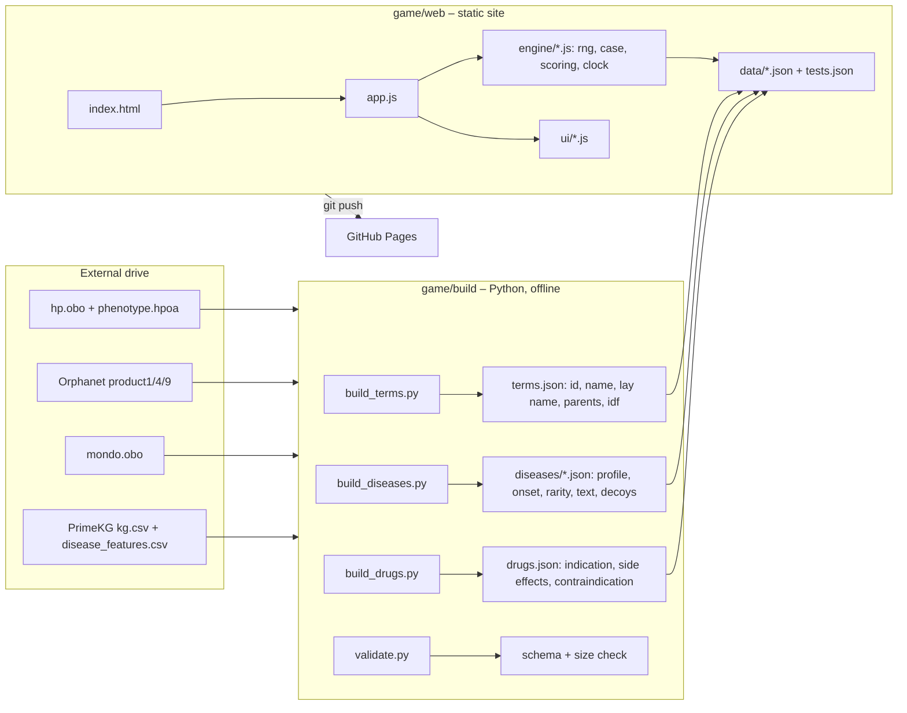

# Plan: "Dr. Diagno" (preliminary name) – a House-style diagnostic game (static JavaScript, GitHub Pages)

Date: 2026-11-05. Status: plan, not started.
Depends on: the data collection in `/media/pc/ext4TB/diagnosis_data/` (see `docs/DATA_OVERVIEW.md`).

## 1. Goal

A browser game in which a patient arrives with puzzling symptoms, the player builds a
differential, orders tests, treats, and must commit to a diagnosis before the patient
deteriorates. Every case is generated from real disease knowledge (HPO, Orphanet, Mondo,
PrimeKG), so the puzzles are medically grounded and the pool is thousands of diseases.

## 2. Hard constraints (from the user and the data)

- **Pure static site.** HTML + ES-module JavaScript, no server, no build-time framework
  required to run. Deployable by pushing to GitHub; served by GitHub Pages.
- **No model at play time.** All content is precomputed into JSON bundles by an offline
  Python build step that reads the drive. The browser only does sampling and scoring.
- **Size budget.** GitHub Pages hard limits: 100 MB per file, ~1 GB per repo. Target:
  ≤ 8 MB of gzipped JSON in total, loaded lazily, so first play starts in < 2 s.
- **Licences.** Only redistribute data whose licence allows it: HPO (free with attribution),
  Orphanet (CC BY 4.0), Mondo (CC BY 4.0), PrimeKG (MIT; its edges CC0/CC BY), Symptom
  Ontology (CC0). Real patient text (PMC-Patients, CC BY-NC-SA) is *not* shipped in v1.
  The site gets a credits page listing sources and versions.
- **Untrusted data rule.** The build scripts live in the project and read the drive with
  `python3 -I`; nothing on the drive is executed.

## 3. Game design

### 3.1 Loop
1. **Admission.** Age, sex, 2–3 presenting complaints in lay language (HPO layperson
   synonyms, 8,077 available), a one-line vitals panel.
2. **Differential.** Player adds candidate diseases via search (Mondo names + synonyms).
   The board shows each candidate's fit against findings so far.
3. **Workup.** Player orders tests from a catalog (history questions, exam manoeuvres,
   labs, imaging, genetics). Each test has a cost in **hours** and **money**, and returns
   findings: HPO terms the hidden disease produces (sampled by annotation frequency), or
   "normal/unremarkable".
4. **Progression.** The clock advances with every action. At scripted thresholds the
   patient gains new findings (ordered by frequency and specificity: common/non-specific
   first, pathognomonic last) and the **stability bar** drops.
5. **Treatment (optional, risky).** Treating a candidate with a drug from PrimeKG
   `indication` edges stabilises the patient if the candidate is right; a wrong drug can
   add findings from PrimeKG `drug_effect` edges and a `contraindication` costs stability.
6. **Commit.** Player names the diagnosis. Debrief shows the true disease, its profile,
   which tests were decisive, and a short explanation (Mondo/Orphanet definition).

### 3.2 Time and failure
- Game clock in hours; a case has a **stability** value 100 → 0. Each hour drains it at a
  rate set by the disease's natural history class (Orphanet product9 onset/course, HPO
  clinical-course terms); treating correctly halts the drain.
- Lose when stability hits 0 or on a wrong commit (one retry allowed on Easy).
- Score = base for correct diagnosis × time multiplier − test cost − harm penalties.
  Leaderboard is local only (`localStorage`); no backend.

### 3.3 Difficulty tiers (data-driven)
| Tier | Disease pool | Notes |
|---|---|---|
| Resident | diseases with ≥ 20 HPO annotations and a Mayo/MedlinePlus text (common) | obvious presentations |
| Attending | ≥ 10 annotations, any rarity (8,488 diseases) | decoys share ≥ 60 % of findings |
| House | Orphanet rare diseases, prevalence < 1/100k, onset data present (≈ 5k) | first findings chosen for *low* specificity |

### 3.4 Case generation (client side, seeded)
```
pick disease D from tier pool (seeded RNG → shareable case code, e.g. #H-7f3a2c)
profile = HPO terms of D with frequency class
present  = 2–3 terms sampled ∝ frequency × (1 − specificity)    # misleading opener
timeline = remaining terms sorted by (frequency desc, specificity asc), spread over N hours
decoys   = top-8 diseases by IDF-weighted overlap with profile (precomputed)
tests    = for each catalog test: findings = profile ∩ test.reveals, drawn ∝ frequency
```
Specificity of a term = inverse document frequency over all disease profiles (how many
diseases carry it). This is the same arithmetic Phenomizer-style tools use and is cheap
in the browser.

### 3.5 The test catalog (the one hand-made asset)
About 60 tests in v1, 150 later, stored as `tests.json`. Each test maps to the HPO
subtrees it can reveal, plus cost, turnaround, and a lay description:
```json
{"id":"cbc","name":"Complete blood count","kind":"lab","hours":1,"cost":30,
 "reveals":["HP:0001871"],"normal":"CBC within normal limits"}
{"id":"mri_brain","name":"MRI brain","kind":"imaging","hours":6,"cost":1200,
 "reveals":["HP:0002011","HP:0012443"]}
{"id":"hx_family","name":"Family history","kind":"history","hours":0.25,"cost":0,
 "reveals":["HP:0000005"]}
```
HPO already has 920 blood terms and 2,480 metabolic/lab terms, so most results come
straight from the disease's annotations. Terms not under any test's subtree are
"spontaneous" findings that only appear through progression.

## 4. Architecture



- **Data split.** `terms.json` (~20k terms, ~1.5 MB gz) loaded once; disease profiles
  sharded by tier and first hex of id (`diseases/attending-0.json` …), loaded on demand;
  `tests.json` and `drugs.json` small.
- **Engine is pure functions** (`createCase(seed, pool)`, `orderTest(state, id)`,
  `advance(state, hours)`, `scoreDifferential(state)`) so it can be unit-tested in Node
  with `node --test`, no browser needed.
- **UI** vanilla JS + CSS, mobile-first, no framework, no bundler. Optional later: a tiny
  reactive helper if the UI grows.
- **Deployment.** Make this project a git repo; GitHub Actions workflow
  `.github/workflows/pages.yml` uploads `game/web/` with `actions/deploy-pages`.
  No gh-pages branch, no copying into `docs/`.

## 5. Repository layout (new)
```
game/
  build/        build_terms.py build_diseases.py build_drugs.py validate.py  (python3 -I, read drive)
  web/
    index.html  app.js  styles.css
    engine/     rng.js case.js tests.js scoring.js clock.js
    ui/         board.js workup.js debrief.js
    data/       terms.json tests.json drugs.json diseases/*.json credits.json
    tests/      *.test.js  (node --test)
  README.md     how to build data, run locally (python -m http.server), deploy
```

## 6. Milestones (checkable)

### M0 Decisions (this document)
- [x] User confirmed 2026-11-05: preliminary name "Dr. Diagno" (to be changed later), English only to begin with, no accounts. Tiers: all three where data allows.

### M1 Data build (Python)
- [ ] `build_terms.py`: parse hp.obo → id, name, layperson synonym, parents, depth; compute
      IDF from phenotype.hpoa; emit `terms.json`.
- [ ] `build_diseases.py`: join phenotype.hpoa (OMIM/ORPHA ids) → Mondo via mondo.obo xrefs;
      attach Orphanet prevalence + onset/natural history (product9), Mondo/Orphanet definition,
      Mayo symptoms text where present (PrimeKG disease_features); compute top-8 decoys;
      assign tier; shard to `diseases/*.json`.
- [ ] `build_drugs.py`: PrimeKG indication / drug_effect / contraindication for diseases in
      the pool → `drugs.json` (names only, no dosing).
- [ ] `validate.py`: JSON schema check, every profile ≥ 10 terms, every referenced term
      exists, total gzipped size ≤ 8 MB, print a dated size report.
- [ ] Credits/attribution file with dataset versions from `_meta.json`.

### M2 Engine (JavaScript, test-first)
- [ ] Seeded RNG (mulberry32) and case-code encode/decode.
- [ ] `createCase`: presentation sampling, timeline, decoys, stability profile.
- [ ] `orderTest`: result generation incl. "normal", turnaround, cost.
- [ ] `scoreDifferential`: IDF-weighted overlap of findings vs. each candidate profile.
- [ ] `advance`: clock, progression reveals, stability drain, treatment effects.
- [ ] `node --test` suite: determinism per seed, no leak of hidden disease name in findings,
      every test resolves, scoring monotonicity, 1,000 random cases run to completion.

### M3 Test catalog content
- [ ] Curate 60 tests → `tests.json` (history 10, exam 10, labs 20, imaging 12, special 8).
- [ ] Coverage check: % of pool profiles with ≥ 3 findings reachable through tests
      (target ≥ 90 %); list uncovered HPO branches to add.

### M4 UI
- [ ] Screens: title/tier select, case board (patient card, clock, stability, findings log,
      differential list with fit bars), order-test drawer, commit dialog, debrief.
- [ ] Search box for diseases (prefix index over Mondo names + synonyms, built client side).
- [ ] Phone layout at 400 px, keyboard operable, light/dark.
- [ ] Shareable case link `#H-xxxxxx`, local best scores.

### M5 Balance and playtest
- [ ] Simulate 10k cases with a greedy bot (orders highest-information test) to tune
      hours/costs so median solve ≈ 8–12 actions and House tier wins ≈ 40 %.
- [ ] Manual playtest of 20 cases per tier; log confusing findings; fix lay names.

### M6 Deploy
- [ ] `git init`, `.gitignore` (no drive data), first commit.
- [ ] GitHub repo + Pages workflow; verify the public URL loads and plays on phone.
- [ ] Lighthouse: performance ≥ 90, first load < 2 s on 4G.

### M7 Documentation
- [ ] `game/README.md` (build, run, deploy, how to add a test), update root README,
      ARCHITECTURE.md (add game subsystem diagram), CHANGES.md, `tasks/todo.md` review,
      lessons.

## 7. Verification plan
- Unit tests in M2 run in CI on every push before deploy.
- `validate.py` output is committed as `game/data_report.md` with a date stamp.
- Playtest log kept in `tasks/house_game_playtest.md`.

## 8. Risks and open questions
- **Test catalog quality** is the main effort and the thing no dataset provides; budget
  two iterations. Mitigation: start with HPO's top-level branches as coarse tests
  ("blood work", "imaging of the head"), refine later.
- **Lay-language gaps**: 8k layperson synonyms cover the common terms; rare terms fall
  back to the HPO label, which is medical jargon. Acceptable for Attending/House tiers.
- **Realistic numbers** (e.g. actual creatinine values) are out of scope without MIMIC-IV;
  results are qualitative findings. Could be added as a later data source.
- **Mondo mapping loss**: some OMIM/ORPHA diseases have no Mondo xref; they are dropped
  from the pool (expected < 5 %, measured in M1).
- **Phase 2 ideas, not in v1**: real case reports converted offline by an LLM into
  playable scripts; multiplayer "team differential"; audio/visual exam findings.

## 9. Out of scope
Any server component, accounts, LLM at runtime, imaging pixels, drug dosing, medical
advice disclaimer beyond a standard "entertainment and education only" notice.
